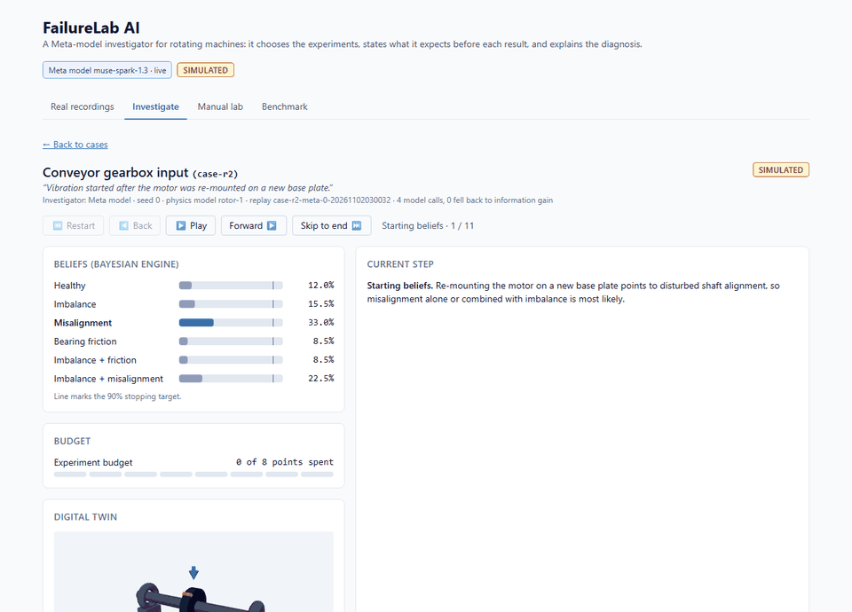
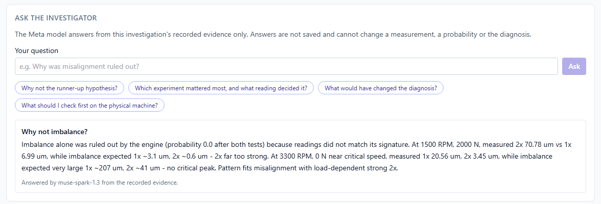
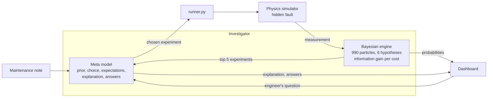
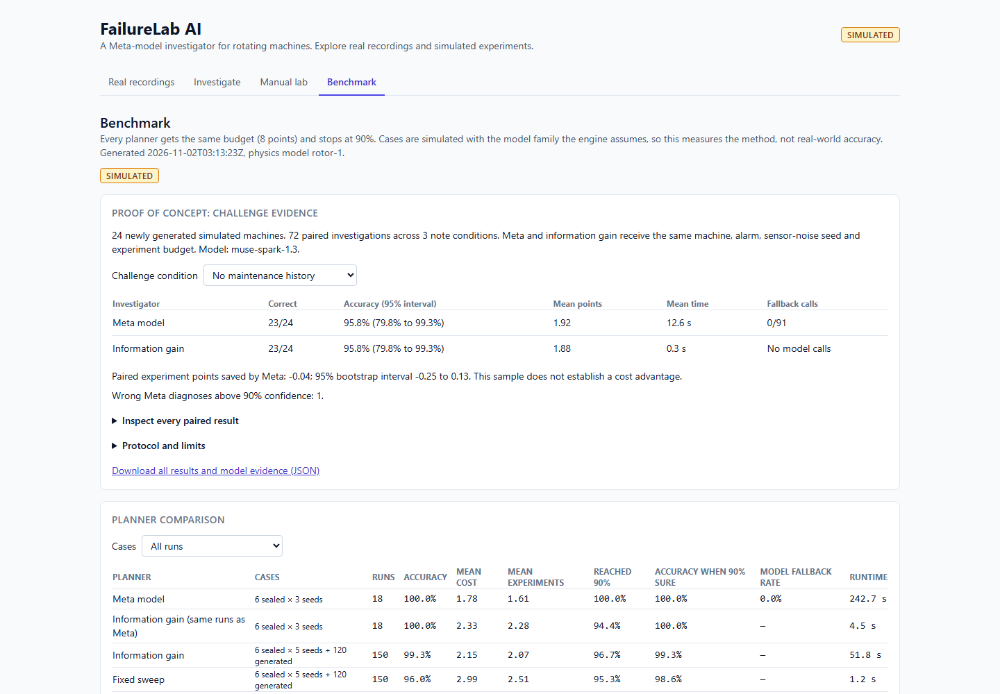
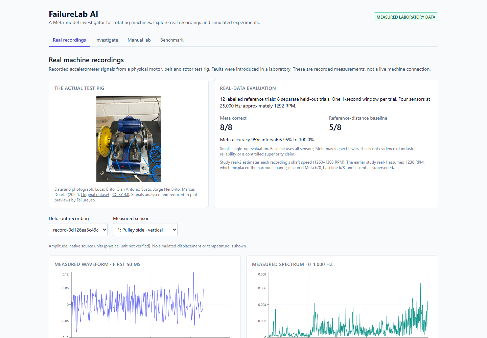

# FailureLab AI

**An AI investigator that finds out why a machine vibrates by running experiments, states
what it expects to see before every result, explains the diagnosis, and answers your
questions from the evidence.**

When a rotating machine starts to vibrate, an engineer has to work out why: imbalance,
misalignment, a failing bearing, or several at once. Each test costs time and machine
downtime. FailureLab AI hands that investigation to a Meta model (Muse Spark 1.3). It
reads the maintenance note, picks the next most informative experiment (speed, load),
**writes down what each possible fault should show there before the result arrives**,
updates its beliefs, and stops as soon as it is confident. Then it explains the diagnosis
and the check to do next, and an engineer can **question it about any reading** it used.

Three roles keep it honest:

- a **physics simulator** (a digital twin of a rotor on bearings) produces every
  measurement;
- a **Bayesian engine** produces every probability;
- the **Meta model** chooses experiments, states predictions, explains and answers
  questions. It never supplies numbers that are scored, and it never sees the true fault.

**Investigation and lab data are simulated.** A separate Real recordings view analyses
attributed accelerometer recordings from a physical laboratory rig
([Real data](docs/REAL_DATA.md)). Built for the Meta Global AI Developer Hackathon 2026
(theme: Push the Frontier, manufacturing; track: Indie Developer).



*One investigation of the saved conveyor-gearbox replay, frame by frame, ending with a live
answer from the Meta model. Still image of the live view:
[live-investigation.png](docs/images/live-investigation.png).*

## Results at a glance

Every number below comes from a file in `backend/results/` that the tests re-check.

| Evidence | Data | Result |
|---|---|---|
| Rule-planner benchmark | 150 simulated runs per planner (6 sealed cases × 5 seeds + 120 generated machines) | Information gain 99.3% correct at 2.15 experiment points; fixed sweep 96.0% at 2.99; random 98.0% at 3.90 |
| Meta model, sealed cases | 18 simulated runs (6 cases × 3 seeds), same runs for both | Meta 100% correct at 1.78 points; information gain 100% at 2.33. 0 fallbacks |
| Meta model, paired challenge | 24 new simulated machines × 3 note conditions (none, misleading, prompt injection): 72 pairs | Meta 23/24 correct in every condition, the same as information gain. Misleading notes and injection did not lower accuracy; no injected text reached an explanation. No cost advantage on these machines (1.92–1.96 vs 1.875 points) |
| Meta model, real recordings | 8 held-out recordings from a physical lab rig (study real-2) | Meta 8/8 correct (95% interval 67.6%–100%); reference-distance baseline 5/8. One rig, eight trials: promising, not proof of industrial reliability |

What we do **not** claim: real-world accuracy from the simulator, a general Meta cost
advantage, or industrial reliability from eight recordings. The first real-data study
(real-1, 6/8 vs 6/8) had a frequency error found in review; it is kept and reported as
superseded ([details](docs/REAL_DATA.md)).

## What the Meta model does here

Most AI demos read data and summarise it. This one **acts** and is **held to account**:

| Stage | The Meta model | The guardrail |
|---|---|---|
| Prior | Turns a human maintenance note into starting beliefs | Renormalised and floored: every hypothesis keeps at least 5%, so a wrong or malicious note cannot rule out the truth |
| Choose | Picks the next experiment from the engine's five most informative candidates, with a rationale | It cannot invent an experiment, a measurement or a probability |
| Predict | States the reading it expects under **each** hypothesis before the result | The dashboard shows its expectation next to the engine's prediction and the measurement |
| Explain | Writes the diagnosis, the remaining doubts and the next physical check | Capped, validated; built only from the trace |
| Answer | Answers an engineer's questions about the finished investigation, quoting readings | Grounded in the saved trace only; answers are never saved and cannot change anything |
| Real signals | Inspects real accelerometer channels one by one and labels the fault | Labels and file names are hidden; 8/8 against a 5/8 statistical baseline |

If the model times out, errs or returns anything unusable, that step falls back to the
information-gain planner and the event is logged. Every model reply is stored in the
trace, so any investigation replays exactly.



## How it works



1. **Prior from the note.** The model turns the maintenance note into starting beliefs.
   Every hypothesis keeps at least 5%, so a wrong or malicious note cannot rule out the
   truth.
2. **Choose and predict.** The engine ranks experiments by expected information per cost
   point. The model picks one of the top five, gives its reason and **states the reading
   it expects under each hypothesis** before the experiment runs.
3. **Measure and update.** The simulator runs the experiment on the hidden machine; the
   engine updates the probabilities. The dashboard shows each hypothesis's predicted
   reading next to the measurement, and which hypotheses gained or lost.
4. **Stop and explain.** At 90% confidence or when the 8-point budget runs out, the model
   explains the diagnosis, the remaining doubts and the check to do next.
5. **Ask.** The engineer questions the finished investigation ("Why not imbalance?",
   "Which reading decided it?"). The model answers from the recorded evidence, quoting
   operating points and readings; the answer is shown, never stored.

## Why the numbers can be trusted

- **The investigator cannot see the answer.** Only `runner.py` touches the hidden fault;
  an architecture test parses every import and fails on any other path.
- **The model cannot inject numbers.** Measurements come from the simulator, probabilities
  from the engine. Model output is parsed defensively, length-capped and validated.
- **Pre-registered studies.** The paired challenge and the real-data study write a frozen
  plan (hashes of code, prompts and splits) before the first model call, and refuse to run
  if it changes. All outcomes are kept, including failures and the superseded study.
- **Reproducible.** All randomness is seeded; rule runs are bit-identical; Meta runs replay
  from their recorded replies. Offline verification re-runs the recorded evidence without
  API calls.
- **Machines nobody has seen.** Besides the six sealed cases, any seed names a new hidden
  machine (`fresh-<seed>`): the fault is drawn by the seeded generator, so neither we nor
  the model know it in advance. Investigate one live from the dashboard.
- **Safe to host.** Closed request schemas, replay-id checks, a cross-site guard on the
  endpoints that start runs, and hourly caps on Meta investigations and questions
  ([decisions D-62 to D-76](docs/DECISIONS.md)).

## Try it in two minutes

```sh
python3.12 scripts/tasks.py setup
python scripts/tasks.py build
python scripts/tasks.py serve        # http://127.0.0.1:8000
```

Or with Docker, from the repository root: `docker build -t failurelab . && docker run --rm
-p 8000:8000 --env-file backend/.env failurelab` (omit `--env-file` to run without a model
key). See [Deployment](docs/DEPLOYMENT.md) for hosting, including a Render blueprint.

1. **Investigate**: choose a case and planner `meta`, then watch it live: the model's
   expectations, each measurement and the probability changes. Then **ask it a question**
   below the diagnosis.
2. **Unseen machine**: type any seed on the dashed card and investigate a machine none of
   us has seen.
3. **Lab**: move the speed and load sliders on the public preset machine and watch the
   3D twin and spectrum respond.
4. **Benchmark**: compare planners, and inspect the paired challenge evidence machine by
   machine.
5. **Real recordings**: inspect real sensor signals, the model's sensor-by-sensor
   reasoning, and reveal each trial's true label.

Without a Meta key, use planner `info_gain` or open the saved Meta replays; the header
says which mode the server is in.

### A five-minute tour for judges

| Minute | Where | What to look for |
|---|---|---|
| 1 | Investigate → Conveyor gearbox input, planner Meta | The note becomes a prior (misalignment favoured, nothing below 5%). The model picks an experiment and states six expected readings **before** the measurement. |
| 2 | Same run, prediction check table | Each hypothesis's predicted 1x, 2x and temperature next to the measurement; probabilities before → after; the engine, not the model, moved them. |
| 3 | Diagnosis → Ask the investigator | Ask "Why not imbalance?" The answer quotes the 2x at 1,500 RPM under load and the missing critical-speed peak at 3,300 RPM. Compare with the experiment log: every number is there. |
| 4 | Unseen machine, any seed | A machine generated from the seed, unknown to everyone. Watch the same loop find it; try the baseline planners for contrast. |
| 5 | Benchmark and Real recordings | 150 simulated runs per planner; the 72-pair challenge with intervals and one retained confident error; 8/8 vs 5/8 on real recordings from one rig, with the photograph and attribution. |

Plans and records: [Product features](docs/PRODUCT_FEATURES.md) ·
[Technical design](docs/TECHNICAL_DESIGN.md) · [Decisions](docs/DECISIONS.md) ·
[Assumptions](docs/ASSUMPTIONS.md) · [API](docs/API.md) ·
[Proof of concept](docs/PROOF_OF_CONCEPT.md) · [Real data](docs/REAL_DATA.md) ·
[Verification](docs/VERIFICATION.md) · [Demo guide](docs/DEMO.md) ·
[Deployment](docs/DEPLOYMENT.md) · [Submission](docs/SUBMISSION.md)

## Setup

Requires Python 3.11+ (3.12 recommended; CI uses 3.12) and Node 22 LTS with npm.

With make (Linux, macOS, CI):

```sh
make setup PYTHON=python3.12   # backend venv + frontend packages
make backend                   # API on http://127.0.0.1:8000 (docs at /docs)
make frontend                  # dashboard on http://localhost:5173, proxies /api
make check                     # lint + tests + build
```

Without make (e.g. Windows), the same commands via Python:

```sh
python3.12 scripts/tasks.py setup
python scripts/tasks.py backend
python scripts/tasks.py frontend
python scripts/tasks.py check
```

For a single-process demo using the production build:

```sh
python scripts/tasks.py build
python scripts/tasks.py serve
```

Open http://127.0.0.1:8000. The dashboard and API share one origin; Node is only
needed to build the frontend. See [Deployment](docs/DEPLOYMENT.md) for hosting setup.

When you investigate a case, the dashboard runs it live over
`GET /api/investigations/stream` (Server-Sent Events; see [API](docs/API.md)). All streamed
data is simulated and labelled as such.

On Windows, Python 3.12 can be installed with the Python install manager
(`pymanager install 3.12`), which provides `python3.12`.

Model access is optional for development. To enable the Meta model investigator, copy
`backend/.env.example` to `backend/.env` (git-ignored) and fill in the `FAILURELAB_LLM_*`
values from a Meta Model API project at dev.meta.ai: model `muse-spark-1.3`, base URL
`https://api.meta.ai/v1` and your API key. Never commit keys.

## Built during the hackathon (26 Oct – 4 Nov 2026)

All code in this repository was written from scratch during the event. Work started on
28 Oct 2026; the first commit was made on 30 Oct 2026 (see D-34 in `docs/DECISIONS.md`).

### 28 Oct 2026

- Plan review; specs converted to Markdown (`docs/`) with resolutions recorded in
  `docs/DECISIONS.md`.
- Workspace skeleton: backend and frontend folders, Makefile, `scripts/tasks.py`, CI.
- Backend: FastAPI app factory, settings from `backend/.env` (`FAILURELAB_` prefix),
  `GET /api/health`, health tests.
- Frontend: Vite + React + TypeScript + Tailwind page that calls `/api/health` through the
  Vite proxy and shows a visible "Simulated" label, with tests.

### 30 Oct 2026

- First commit (skeleton).
- Physics simulator (`app/physics/model.py`): vectorised Jeffcott-rotor response (1x, 2x,
  broadband, bearing temperature rise), seeded noisy measurement with least-squares feature
  extraction, alarm RMS, spectrum and waveform preview. Tests check each fault's signature,
  determinism, extraction accuracy and the stated noise spread.
- Six sealed cases, public `CaseView` and a seeded generator for benchmark cases
  (`app/cases.py`); `make_runner` as the only bridge to hidden truth (`app/runner.py`).
- Architecture test that fails on forbidden imports.
- Bayesian engine (`app/inference/engine.py`): 990-particle grid over six hypotheses,
  log-space updates for experiments and the alarm, vectorised expected information gain,
  candidate ranking by information per cost, per-hypothesis predictions. Tests cover the
  grid, priors, posterior normalisation, each hypothesis winning on clean evidence,
  non-negative and seeded information gain, ranking rules and speed.
- Rule planners `info_gain`, `sweep`, `random` (`app/agent/planners.py`) and the
  investigation loop (`app/agent/investigate.py`): prior, alarm, predictions recorded before
  each run, posterior updates, stopping at 90% or budget, diagnosis with doubts and a
  recommended check, and a JSON trace. Tests cover budget, repeats, sweep order, seeded
  bit-identical traces, no hidden values in traces, sealed-case accuracy and speed.
- API (`app/api/`, `app/schemas/`): `/api/ready`, `/api/cases`, `/api/experiments`,
  `/api/lab/simulate`, `/api/investigations` (run, save, list, load) with closed request
  schemas, replay storage with id checks, and a clear 503 for an unconfigured Meta model.
  Tests cover 422/404/400/503 paths, public fields only, no hidden values and the replay
  round trip. Reference in `docs/API.md`.
- Meta model investigator (`app/agent/meta_planner.py`, `app/agent/llm_client.py`): the
  model turns the note into a prior (floored at 5%), picks one of the engine's top five
  experiments with a rationale and an expected reading per hypothesis, and writes the
  explanation. Output is parsed defensively and capped; any failure falls back to
  `info_gain` and is logged in `llm_events` with the raw response, so replays are identical.
  Tests use a fake model (valid and invalid output, timeouts, prompt leakage, note
  injection, replay identity) and a mocked HTTP transport; a live smoke test runs only when
  `backend/.env` configures the model.
- Benchmark (`backend/scripts/benchmark.py`, `GET /api/benchmark`): rule planners on six
  sealed cases × 5 seeds plus 120 generated cases; `--planner meta` runs separately with a
  response cache and a call limit. Results in `backend/results/benchmark.json`.
- Dashboard player (`frontend/src/`): typed API client, case picker with investigator and
  seed choice and saved replays, and a step player (play, pause, back, forward, skip) that
  shows each experiment's choice and reasoning, then predictions, then the measurement and
  spectrum, then updated probabilities, with budget, experiment log and a final diagnosis
  card. Tests cover frame order, hidden-until-revealed measurements, diagnosis only at the
  end, numeric probabilities, auto-play and the case picker.
- Manual lab (`frontend/src/lab/ManualLab.tsx`): fault, speed and load sliders on the public
  preset machine with debounced simulation, live readings, a simulator-computed response
  curve, spectrum and waveform. Tests cover the request, debouncing and errors.
- 3D digital twin (`frontend/src/twin/`): shaft, bearings and load arrow in React Three
  Fiber, lazy-loaded. Spin follows RPM (20× slower, labelled), whirl follows measured 1x
  (1,000× exaggeration, stated), strong 2x draws a figure-eight, broadband adds seeded
  jitter, bearing tint follows temperature rise. Before any measurement it shows no whirl.
  Tests target the mapping functions; WebGL rendering itself is not tested.
- Benchmark screen (`frontend/src/benchmark/BenchmarkView.tsx`) with a case-group filter,
  and curated demo replays in `backend/replays/demo/` created by
  `backend/scripts/demo_replays.py`; a test re-runs every demo replay and checks it is
  identical (Meta replays through the recorded model responses).
- Hardening after an independent code review and a headless-browser check of every screen
  in light, dark and phone layouts: each replay id listed once, atomic replay writes,
  unreadable replays skipped (404 instead of 500), unique Meta ids within the same second,
  model clients closed after each run, every model-client error falls back, prior overflow
  guarded, one shared serialiser for traces and API responses, and the Meta benchmark now
  also runs `info_gain` on exactly the same runs so the comparison is like for like.
- Meta model confirmed: Muse Spark 1.3 on Meta's Model API (OpenAI-compatible chat
  completions); the adapter sends `max_completion_tokens` and `reasoning_effort` because
  Muse Spark always reasons (D-55).

### 1 Nov 2026

- Reran all three rule benchmarks (450 simulated investigations total); accuracy and cost
  reproduced the earlier results. Runtime was 54.2 s in total.
- Checked 25 browser views: cases, investigation, diagnosis, lab and benchmark at desktop
  and phone sizes in light and dark themes, plus a 320-pixel phone layout. The 3D twin rendered in Chromium; no uncaught
  page errors or page-level horizontal overflow were observed.
- Fixed fractional/out-of-range seed inputs and disabled replay opening while a run loads.
- Made concurrent saves of the same replay id use independent temporary files, with a
  regression test for two simultaneous writers.
- Added baseline demo replays for the other three cases, so all six cases are available.
- Added a recording guide, submission draft and verification record.
- Added a single-process production demo command, static-asset/API integration tests and
  deployment instructions. CI now checks Windows as well as Linux.
- Final check: backend 216 passed, 1 live-model test skipped; frontend 45 passed;
  Ruff, ESLint, TypeScript and the production build passed. Optional browser checks use
  Playwright 1.64.1 (Apache-2.0) installed outside the app dependency tree.

### 2 Nov 2026

- Live Meta benchmark on the six sealed cases × 3 seeds (18 investigations, 53 new API
  calls, 0 fallbacks), with information gain on exactly the same runs.
- Paired proof challenge (`scripts/proof.py`): 24 new generated machines × 3 note
  conditions, frozen plan, checkpoint and resume, Wilson and paired-bootstrap intervals,
  downloadable evidence and offline verification ([Proof of concept](docs/PROOF_OF_CONCEPT.md)).
- Real recordings path (`app/measured.py`, `scripts/fetch_real.py`,
  `scripts/real_examples.py`, Real recordings view): attributed CC BY 4.0 laboratory
  recordings, measured features, a trial-disjoint split and Meta sensor-by-sensor
  assessment with labels hidden.
- Live investigation stream (`GET /api/investigations/stream`) and a live dashboard view.
- Full code review, then fixes with tests (D-62 to D-70): model replies can no longer crash
  a run; the stream saves the trace before its final frame; cross-site guard and an hourly
  Meta cap; settings validated at startup; harmonics need two shaft turns; stricter
  architecture test; compact, gzip-served evidence.
- Real-data correction: the review found the harmonic bands assumed 1238 RPM while the rig
  runs at 1,260–1,302 RPM. Study real-1 is preserved as superseded; pre-registered study
  real-2 estimates the speed per recording (Meta 8/8, baseline 5/8).
- **Ask the investigator** (D-75): `POST /api/investigations/{id}/ask` and a dashboard
  panel below every diagnosis. The Meta model answers an engineer's question from the
  saved trace's evidence only; answers are capped, never saved, rate-limited separately
  and fall back to the recorded explanation on any model failure. Tests cover grounding,
  no hidden values in the prompt, caps, fallbacks, cross-site refusal and the hourly cap;
  two live answers were checked against the recorded readings they quote.
- **Unseen machines** (D-74): `fresh-<seed>` ids name a new hidden machine derived from the
  seed alone, accepted by every case endpoint; `GET /api/cases/{id}` returns its public
  view and the case picker offers it on a dashed card. Tests cover reproducibility, label
  coverage, canonical ids, no hidden values and a bit-identical round trip.
- Header status chip showing the configured model, and a one-command container
  (`Dockerfile`, `.dockerignore`, `render.yaml`; D-76) with a CI job that builds and
  smoke-tests the image on Linux.
- Evidence trail at the diagnosis (replay and live views): each experiment's readings, the
  hypothesis it lifted most and where the diagnosis stood after it, all from the trace.
  README walkthrough GIF captured from the production dashboard with Playwright.

## Benchmark results (simulated)

Measured again on 1 Nov 2026 with `python scripts/tasks.py benchmark` (150 runs per planner:
6 sealed cases × 5 seeds + 120 generated cases; budget 8 points; stop at 90%). All cases
are simulated with the same model family the engine assumes, so these numbers show the
method works when the model is structurally right, not real-world accuracy.

| Planner | Accuracy | Mean cost (points) | Mean experiments | Reached 90% | Runtime |
|---|---|---|---|---|---|
| `info_gain` | 99.3% | 2.15 | 2.07 | 96.7% | 51.8 s |
| `sweep` | 96.0% | 2.99 | 2.51 | 95.3% | 1.2 s |
| `random` | 98.0% | 3.90 | 2.79 | 94.0% | 1.3 s |

On this simulator every planner usually finds the fault within budget; the clear
difference is cost: `info_gain` needs about 28% fewer points than the fixed sweep and 45%
fewer than random choice. The hardest hypothesis is misalignment (`info_gain` 96%, `sweep`
84%). The Meta model results follow.

### Against the targets set before building

Targets from `docs/PRODUCT_FEATURES.md` §6. Numbers from `backend/results/` and the test
suite; "not established" means the data does not support the target.

| Metric | Target | Measured | Met |
|---|---|---|---|
| Accuracy on 120 unseen simulated cases | ≥ 95% | `info_gain` 99.2%, `sweep` 95.0%, `random` 98.3% | Yes (`info_gain`) |
| Cost, information gain vs fixed sweep | Lower at equal accuracy | 2.15 vs 2.99 points, accuracy 99.3% vs 96.0% | Not established at equal accuracy |
| Cost, Meta model vs information gain on cases with notes | Equal or lower | 1.78 vs 2.33 points on the 18 sealed runs; 1.92–1.96 vs 1.875 on the 72-pair challenge (paired intervals include zero) | Not established in general |
| Accuracy when the system says ≥ 90% | ≥ 90% | `info_gain` 99.3%, `sweep` 98.6%, `random` 100% | Yes |
| Meta model fallbacks | < 5% of calls | 0 fallbacks in about 65 stages (53 new calls) and in 273 stages (209 new calls); identical prompts reuse a recorded reply | Yes on these samples |
| Investigation time without the model | < 2 s | Under 2 s (`test_investigation_is_fast`; `info_gain` on sealed cases 0.1–0.6 s, seed 0) | Yes |
| Rule-planner benchmark run time | < 2 min | 54.2 s for all three planners | Yes |
| Sealed demo cases diagnosed correctly | 6 of 6 | `info_gain` 6 of 6 on all 5 seeds (30 of 30 runs) | Yes (`info_gain`) |

### Meta model on the sealed cases (2 November 2026)

Muse Spark 1.3 (`muse-spark-1.3`) completed six sealed simulated cases with three seeds
each (18 investigations), using 53 new API calls in 242.69 seconds, with zero fallbacks.
Both planners ran on exactly the same cases and seeds.

| Planner | Accuracy | Mean experiment cost | Mean experiments | Reached 90% |
|---|---|---|---|---|
| Meta | 100% | 1.7778 | 1.6111 | 100% |
| Information gain, same runs | 100% | 2.3333 | 2.2778 | 94.44% |

On this small sample Meta used about 23.8% fewer experiment points, helped by the case
notes. Experiment cost measures simulated experiment budget, not API billing or latency.

### Paired challenge (2 November 2026)

The [paired challenge](docs/PROOF_OF_CONCEPT.md) runs Meta and information gain on the
same 24 newly generated machines and sensor noise, with no note, a misleading note and a
prompt-injection note. Both scored 23/24 (95.8%, 95% interval 79.8%–99.3%) in every
condition. Meta had zero fallbacks across 273 recorded stages (209 new API calls;
identical prompts reuse a recorded reply, so the injection prior was in effect sampled
once). No experiment-cost advantage was established on these machines. Run
`python scripts/tasks.py proof`; inspect the evidence on the Benchmark screen.



### Real recordings (2 November 2026)

Open `http://127.0.0.1:8000/?view=real`. Study real-2 uses 12 labelled reference trials
and eight separate held-out trials from a physical rig: Meta 8/8 (95% interval
67.6%–100%), reference-distance baseline 5/8, 32 calls, no model errors. Superseded study
real-1 (6/8 each) is preserved. Dataset and photograph: Brito, Susto, Brito and Duarte
(2022), DOI 10.17632/zx8pfhdtnb.1, CC BY 4.0; analysis code is original. See
[Real data](docs/REAL_DATA.md).



### Dependencies

Direct dependencies, pinned to exact versions:

| Package | Version | Use | License |
|---|---|---|---|
| FastAPI | 0.143.1 | Backend API | MIT |
| Uvicorn | 0.54.0 | ASGI server | BSD-3-Clause |
| Pydantic | 2.14.1 | Schemas and validation | MIT |
| pydantic-settings | 2.16.0 | Settings from `.env` | MIT |
| NumPy | 2.5.4 | Physics and inference | BSD-3-Clause (bundled parts: 0BSD, MIT, Zlib, CC0-1.0) |
| httpx | 0.28.1 | Meta model adapter; test client | BSD-3-Clause |
| setuptools | 84.0.0 | Backend build backend | MIT |
| pytest | 9.1.1 | Backend tests | MIT |
| Ruff | 0.17.0 | Backend lint and format | MIT |
| React, React DOM | 19.3.1 | Frontend UI | MIT |
| Recharts | 3.10.1 | Spectrum and response charts | MIT |
| react-is | 19.3.1 | Peer dependency of Recharts | MIT |
| three | 0.186.1 | 3D twin rendering | MIT |
| @react-three/fiber | 9.8.1 | React renderer for three.js | MIT |
| @types/three | 0.186.0 | three.js type definitions | MIT |
| Vite | 8.3.4 | Frontend dev server and build | MIT |
| @vitejs/plugin-react | 6.1.2 | React support for Vite | MIT |
| TypeScript | 6.0.3 | Frontend language | Apache-2.0 |
| Tailwind CSS | 3.4.19 | Styling | MIT |
| PostCSS | 8.5.30 | CSS processing | MIT |
| Autoprefixer | 10.6.1 | CSS vendor prefixes | MIT |
| Vitest | 5.0.4 | Frontend tests | MIT |
| jsdom | 30.1.2 | DOM for tests | MIT |
| @testing-library/react | 16.3.3 | Component tests | MIT |
| @testing-library/dom | 10.4.2 | Component tests | MIT |
| @testing-library/jest-dom | 7.0.1 | DOM matchers | MIT |
| ESLint | 10.12.0 | Frontend lint | MIT |
| @eslint/js | 10.0.1 | ESLint rules | MIT |
| typescript-eslint | 8.71.2 | TypeScript lint | MIT |
| eslint-plugin-react-hooks | 7.1.1 | React hooks lint | MIT |
| eslint-plugin-react-refresh | 0.5.7 | Vite fast-refresh lint | MIT |
| globals | 17.13.0 | ESLint globals | MIT |
| @types/react, @types/react-dom | 19.3.0 | React type definitions | MIT |
| GitHub Actions (checkout, setup-python, setup-node) | v5 / v6 / v5 | CI | MIT |

Transitive dependencies are under compatible licenses: permissive (MIT, BSD, Apache-2.0,
ISC), MPL-2.0 used unmodified (e.g. certifi), and CC-BY-4.0 data (caniuse-lite). No GPL or
AGPL code is used. The container image builds on the Docker official `node:22-alpine` and
`python:3.12-slim` images (Node: MIT; Python: PSF; base OS packages under their own
permissive or copyleft-unmodified licenses); no image is published by this repository.

## License

Code: MIT, see [LICENSE](LICENSE). Real recordings and the test-rig photograph: CC BY 4.0,
attributed in [Real data](docs/REAL_DATA.md).
